# 🎧 Awesome Customer Service Agent Workspace 🚀

 

 

> 🌐 A comprehensive, curated directory of world-class **SaaS platforms** and **open-source GitHub projects** powering modern **Customer Service Agent Workspaces**, unified team inboxes, omnichannel ticketing systems, and AI-assisted agent desktop infrastructure. ✨

Customer service agent workspaces empower support agents, customer experience (CX) representatives, and helpdesk administrators with a unified console to manage customer interactions across email, live chat, SMS, social channels, and voice. 📥 By consolidating interaction history, CRM context, ticketing workflows, and AI copilot intelligence into a single pane of glass, these tools streamline issue resolution and eliminate tab fatigue. 🚀

---

## 📑 Table of Contents
- [📊 Sector Overview & Market Dynamics](#-sector-overview--market-dynamics)
- [💼 SaaS / Hosted Platforms](#-saas--hosted-platforms)
- [💻 Open-Source GitHub Projects](#-open-source-github-projects)
- [🎯 How to Choose an Agent Workspace](#-how-to-choose-an-agent-workspace)
- [🤝 How to Contribute](#-how-to-contribute)
- [⭐ Star History](#-star-history)
- [💖 Support & Sponsorship](#-support--sponsorship)
- [⚖️ Disclaimer](#️-disclaimer)

---

## 📊 Sector Overview & Market Dynamics

The global customer service and Contact Center as a Service (CCaaS) market is estimated at approximately **$47B to $52B**, with the broader customer experience software segment expanding at a **10%–11% CAGR** and AI-agentic workspace sub-segments compounding at over **25%+ CAGR** 📈. The sector exhibits a **moderately to highly fragmented** competitive landscape 🌐: legacy and enterprise CRM giants (Salesforce, ServiceNow) command high-end, complex enterprise suites 🏢, mid-market SaaS platforms (Zendesk, Freshworks, Intercom, Front) compete aggressively on product-led usability and generative AI copilots 🤖, and emerging open-source platforms (Chatwoot, Zammad, FreeScout, TGO) offer self-hosted data sovereignty against seat-based licensing costs 🔓.

---

## 💼 SaaS / Hosted Platforms

Below is a breakdown of top commercial customer service agent workspace software, ordered by company size (valuation / market capitalization, descending) 📉.

| Product 🏷️ | Company Valuation / Revenue 🏢 | Description 📝 | Pricing (Starting Tier) 💰 | Free Tier / Trial Limits 🎁 |
|:---|:---|:---|:---|:---|
| **[Salesforce Service Console](https://trailhead.salesforce.com/)** | **~$180B Market Cap** (~$41.5B FY26 Rev) | Enterprise three-column service agent workspace integrating omnichannel case feeds, customer 360 highlights, macro automation, and Agentforce AI copilot assistance. | **$25/user/month** (Starter Suite, billed annually); $100/user/month (Pro Suite); $175/user/month (Enterprise) | **30-day free trial** with full Starter/Pro feature access; no credit card required. No permanent free tier. |
| **[ServiceNow Agent Workspace](https://www.servicenow.com/community/)** | **~$110B Market Cap** (~$15.4B TTM Rev) | Single-pane-of-glass multi-tabbed graphical workspace for tier 1-3 service fulfillers, featuring playbook automation, interaction timelines, and Now Assist AI guidance. | **~$130/user/month** (CSM Fulfiller license baseline; enterprise annual contract required) | **No permanent free tier**; evaluated via sales-assisted guided Proof of Concept (PoC) or developer sandboxes. |
| **[Zendesk Agent Workspace](https://support.zendesk.com/hc/en-us/sections/4405303726490)** | **~$10.2B Acquisition Valuation** (~$1.7B+ ARR) | Contextual agent interface consolidating email, chat, social messaging, voice, and help center knowledge into a single collaborative thread. | **$19/agent/month** (Support Team, annual); **$55/agent/month** (Suite Team Omnichannel, annual) | **14-day free trial** with access to Suite Professional features; no credit card required. No permanent free plan. |
| **[Freshworks Freshdesk Omni](https://www.freshworks.com/freshdesk/omni/agent-workspace/)** | **~$3.3B Market Cap** (~$700M+ ARR) | Unified omnichannel agent workspace bringing tickets, live customer timelines, Freddy AI suggestions, and team chat together in one interface. | **$15/agent/month** (Growth plan, billed annually) or $19/agent/month (billed monthly) | **14-day free trial** on Growth/Pro tiers without credit card. Free basic plan limited to up to 10 agents with email ticketing only. |
| **[Intercom Inbox](https://www.intercom.com/)** | **~$3.6B Valuation** (Fin AI exit to Salesforce benchmark) | Modern conversation inbox built around real-time messaging, ticketing workflows, Fin AI autonomous resolution, and agent copilot drafting. | **$29/seat/month** (Essential plan, billed annually; excludes Fin AI per-resolution charges) | **14-day free trial** with access to core Inbox features; no credit card required. No permanent free tier. |
| **[Front](https://front.com/)** | **~$1.7B Valuation** (Series D) | Collaborative team inbox uniting shared email, live chat, SMS, and messaging channels with internal comments, SLAs, and automated routing. | **$25/seat/month** (Starter plan, annual; capped at 10 seats); $65/seat/month (Professional) | **14-day free trial** of Professional plan (capped at 15 teammates, 5 workspaces, 30 channels, and 5,000 messages total). No permanent free tier. |
| **[Kustomer](https://www.kustomer.com/)** | **~$250M–$1B Valuation** (Meta spin-out / Series B) | Continuous timeline-based CRM and agent workspace enabling direct order management, billing lookups, and conversational omnichannel support. | **$89/user/month** (Enterprise plan, billed annually) or $139/user/month (Ultimate plan) | **14-day free trial** available via sales consultation / Shopify app installation. No permanent free tier. |
| **[Gladly](https://www.gladly.com/)** | **~$150M–$300M Est. Valuation** (~$40M ARR) | People-centered customer service platform featuring a lifetime conversation thread across voice, SMS, email, and social without tickets. | **~$150–$180/user/month** (Enterprise contracts typically starting at $100K+/year platform commitment) | **No permanent free tier**; interactive evaluations provided strictly through sales-guided product demos. |
| **[Help Scout](https://www.helpscout.com/pricing/)** | **~$100M–$200M Est. Valuation** (~$30M ARR) | Intuitive shared inbox, live chat, and knowledge base workspace equipped with AI summarization, drafts, and customer context sidebars. | **$25/user/month** (Standard plan, billed annually) or $45/user/month (Plus plan) | **Free forever plan**: Up to 5 users, 1 shared inbox, and 1 Docs site. Also offers a **15-day free trial** of paid plans with full features. |
| **[LiveAgent](https://www.liveagent.com/pricing/)** | **Bootstrapped / Profitable** (~$10M+ ARR) | Omnichannel helpdesk with universal ticket inbox, embedded live chat, call center, social media integrations, and customizable customer portal. | **$15/agent/month** (Starter plan, billed annually) or $19/agent/month (billed monthly) | **Free forever plan**: 1 agent, 1 incoming email account, 1 chat button, and 7-day ticket history. Also offers a **30-day free trial** of all premium features (no credit card). |

---

## 💻 Open-Source GitHub Projects

Curated self-hosted and open-source customer service platforms and agent workspaces, ordered by GitHub Stars_Count (descending) 🌟. Each Stars_Badge links directly to that repository's stargazers.

| Project 🛠️ | GitHub_Stars ⭐ | Primary Stack 💻 | Description 📖 |
|:---|:---:|:---|:---|
| **[Chatwoot](https://github.com/chatwoot/chatwoot)** |  | Ruby on Rails, Vue.js | Real-time omnichannel customer support platform and agent workspace. Connects website live chat, email, WhatsApp, Telegram, Facebook, and Instagram into a unified team inbox with canned responses, private notes, and auto-assignment. |
| **[Papercups](https://github.com/papercups-io/papercups)** |  | Elixir, Phoenix, React | Open-source live customer messaging workspace with embeddable chat widgets, Slack two-way sync, and developer-friendly REST/GraphQL APIs. |
| **[Zammad](https://github.com/zammad/zammad)** |  | Ruby on Rails, PostgreSQL | Full-featured web-based customer support system and helpdesk. Offers multi-channel support (email, chat, telephone, Twitter, Facebook), collision detection, audit-compliant ticket logging, and elastic full-text search. |
| **[FreeScout](https://github.com/freescout-help-desk/freescout)** |  | PHP, Laravel, MySQL | Lightweight, self-hosted omnichannel helpdesk and shared mailbox built as an open-source alternative to Help Scout and Zendesk. Features collision detection, push notifications, canned responses, and module-based extensibility. |
| **[osTicket](https://github.com/osTicket/osTicket)** |  | PHP, MySQL | Battle-tested open-source support ticket system. Automatically routes inquiries created via email, web forms, and API calls with SLA plans, custom ticket fields, and role-based staff assignments. |
| **[Frappe Helpdesk](https://github.com/frappe/helpdesk)** |  | Python, Frappe, Vue 3 | Modern, streamlined customer service software built on Frappe Framework. Delivers clean ticket routing, SLA timers, customer knowledge base integration, and native ERPNext connectivity. |
| **[Live Helper Chat](https://github.com/LiveHelperChat/livehelperchat)** |  | PHP, JavaScript | Flexible live support system featuring web and mobile apps, voice, video, screenshare, Telegram, WhatsApp, and Facebook Messenger bot integration for customer support reps. |
| **[Trudesk](https://github.com/polonel/trudesk)** |  | Node.js, MongoDB, React | Real-time open-source help desk and ticketing workspace with integrated task management, live notifications via WebSockets, and granular permission access. |
| **[TGO](https://github.com/tgoai/tgo)** |  | Python, FastAPI, TypeScript | Open-source AI agent customer service platform paired with a dedicated human agent workspace. Combines multi-agent LLM orchestration, RAG knowledge bases, MCP tool integration, and seamless human-in-the-loop escalation handoffs. |

---

## 🎯 How to Choose an Agent Workspace

When evaluating commercial SaaS platforms versus self-hosted open-source software, consider 🔍:
1. **Channel Coverage 📡:** Does the platform natively ingest email, live chat, social DMs, and voice into a unified customer thread?
2. **AI Copilot & Autonomous Routing 🤖:** Does the workspace offer real-time summarization, suggested replies, and automated ticket classification?
3. **Data Sovereignty & Privacy 🔒:** High-compliance industries (fintech, healthcare, government) often mandate self-hosted solutions (e.g., Zammad, Chatwoot, FreeScout) to satisfy GDPR, HIPAA, and SOC2 data residency requirements.
4. **Total Cost of Ownership (TCO) 💵:** Commercial per-seat tiers scale quickly as support headcount expands ($25–$180+/agent/month), whereas open-source alternatives trade seat fees for infrastructure hosting and maintenance.

---

## 🤝 How to Contribute

Contributions are warmly welcome! 🙌 To suggest or update a platform:
1. 🍴 Fork this repository.
2. 📝 Update `README.md` following the existing tabular structure.
3. 🔍 Include verified pricing, free tier/trial limits, or Stars_Badges.
4. 🚀 Submit a Pull Request with a clear description and authoritative reference link.

---

## 📈 Star History

---

## 💖 Support & Sponsorship

Thank you so much for exploring and using this repository! 🙏 If you find this curated list valuable for your team or customer support infrastructure, please consider supporting the project:

- ⭐ **Star this repository** to help others discover it.
- 🍴 **Fork and contribute** your favorite agent workspace tools and projects.
- 📢 **Share this project** on Twitter/X, LinkedIn, Reddit, or Discord.
- ☕ **Buy me a coffee / Sponsor the project:** Support ongoing maintenance and curation on the [GitHub Sponsor Dashboard](https://github.com/sponsors/ishandutta2007).

---

## ⚖️ Disclaimer

- 📌 This list is community-curated for informational and architectural comparison purposes.
- 💡 Product pricing and free trial terms reflect public vendor disclosures as of 2026 and are subject to change.
- ⚡ Stars_Counts and metrics are updated periodically via the GitHub API.

---

**[⭐ Star this repository](https://github.com/ishandutta2007/Awesome-Customer-Service-Agent-Workspace) to keep up with the latest updates!**

